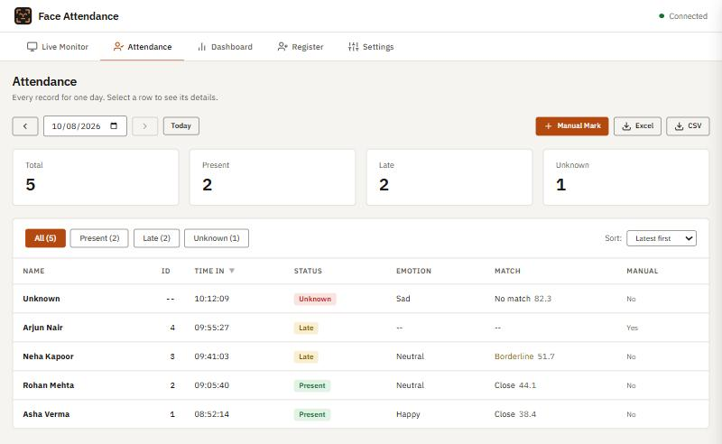

# Face Insight

Face recognition, emotion detection and attendance from a webcam.

Take attendance with a webcam. The app finds faces in the camera feed, recognises the people you have registered, and writes down who showed up and when. It also takes a guess at each person's expression. Everything runs on your own computer and you drive it from a browser tab.

This is version 1. It is meant for one PC with one camera, on a network you trust. There is no login yet, so please don't put it on the open internet. The section "What it can't do yet" has the full list.



*The Attendance tab, with sample data.*

## What's in it

**Live Monitor.** The camera feed with a box and a name on every face, live counts, and a running list of who was just logged. Click an entry to open its record.

**Attendance.** One day at a time. Filter by Present, Late or Unknown, sort the table, open a record to see the face crop that triggered it, mark someone by hand, export the day to Excel or CSV, and delete an entry that should not be there.

**Dashboard.** Totals for today, an attendance trend over 7, 14 or 30 days, today's expressions, and how many days each person attended.

**Register.** Capture face images for a new person straight from the camera, then train the recogniser. The new model is picked up without restarting.

**Settings.** Light, dark or system mode, eight colour themes, the database connection, the late cut-off and cooldown, the list of names, and a reset for today's records.

## How it works

1. OpenCV's Haar cascade finds faces in every third frame.
2. An LBPH recogniser (from `opencv-contrib-python`) compares each face with the images you collected and returns a distance. Under the threshold counts as a match.
3. A small Keras model labels the expression as one of seven classes.
4. The attendance engine decides whether that sighting becomes a record. One person is logged once per cooldown period, and anyone arriving after the cut-off time is marked Late.
5. Flask serves the page and the API, Socket.IO pushes live updates, and MongoDB stores the records.

The front end is plain HTML, CSS and JavaScript. There is no build step and no framework. Charts are drawn with Chart.js.

## Setup

You need:

- Python 3.11 (the version this was written and run on)
- MongoDB running locally on the default port
- A webcam

```bash
git clone <your-repo-url>
cd Face-Insight
python -m venv .venv
.venv\Scripts\activate
pip install -r requirements.txt
python server.py
```

Then open http://localhost:5000.

The first start takes a few seconds, because TensorFlow has to load and the app checks which cameras really return a picture.

If MongoDB is not running, the app still starts. You get a "Database offline" banner and nothing is saved until it comes back.

## First run

1. Open **Register**. An ID is suggested for you. Type a name and press **Start Collection**.
2. Look at the camera and turn your head slowly while it collects images. The default is 500.
3. Training starts by itself when collection finishes.
4. Go to **Live Monitor** and press **Start**. Your name should appear on the box around your face, and a record lands on the Attendance tab.

## Settings worth knowing

| Setting | Where | What it does |
|---|---|---|
| Recognition threshold | Live Monitor | The largest match distance still accepted as a known person. Lower is stricter. |
| Auto attendance | Live Monitor | Turns automatic logging on or off. Manual marks always work. |
| Cooldown | Settings | Minutes before the same person can be logged again. |
| Late after | Settings | Arrivals after this time are marked Late. |

These are stored in `config.json`, which is created the first time you run the app. It is not in the repository because it holds your names and database address.

## Project layout

```
server.py          Flask app: routes, socket handlers, wiring
core/              camera loop, detection, image collection, training
attendance/        attendance rules and Excel/CSV export
db/                MongoDB wrapper and the optional Firebase mirror
models/            Haar cascade and the expression model
web/templates/     the single HTML page
web/static/        CSS, one JS file per tab, icons
tests/             test scripts
docs/              architecture notes and the roadmap
```

[docs/architecture.md](docs/architecture.md) explains how the parts talk to each other and lists every route and event.

## Tests

```bash
python tests/run_all.py
```

The tests are plain Python scripts, so there is nothing extra to install. They work on a separate database called `face_attendance_test` and on temporary copies of the config, so your own records are left alone. MongoDB has to be running, and a couple of checks only run when the camera is free.

## Your data

Face images (`ImageData/`), face crops (`snapshots/`), the trained model (`Trainer.yml`) and `config.json` are all listed in `.gitignore`. They stay on your machine. If you fork this, keep it that way: those files are biometric data about real people.

Ask people before you register their face.

## What it can't do yet

- **No login.** Anyone who can reach the page can change settings, delete people and clear records.
- **Recognition is basic.** LBPH is sensitive to lighting, angle and glasses, and there is no liveness check, so a photo held up to the camera can pass. I have not measured its accuracy.
- **Expression is a rough guess.** Treat it as a curiosity, not a fact about someone.
- **Records are per sighting.** A person gets a new row every time the cooldown runs out, not one check-in per day.
- **Only tried on Windows.**

[docs/roadmap.md](docs/roadmap.md) covers what the next version needs.

## Credits

- Face detection uses the frontal-face Haar cascade that ships with [OpenCV](https://opencv.org/).
- Type is [IBM Plex](https://github.com/IBM/plex).
- Charts are [Chart.js](https://www.chartjs.org/), live updates are [Socket.IO](https://socket.io/).
